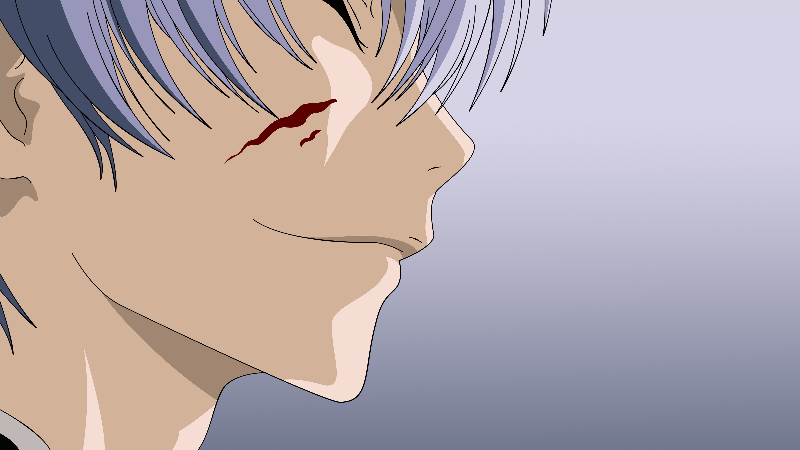
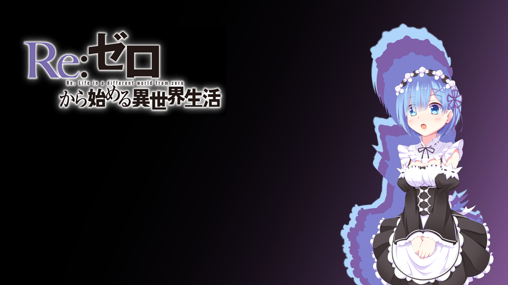
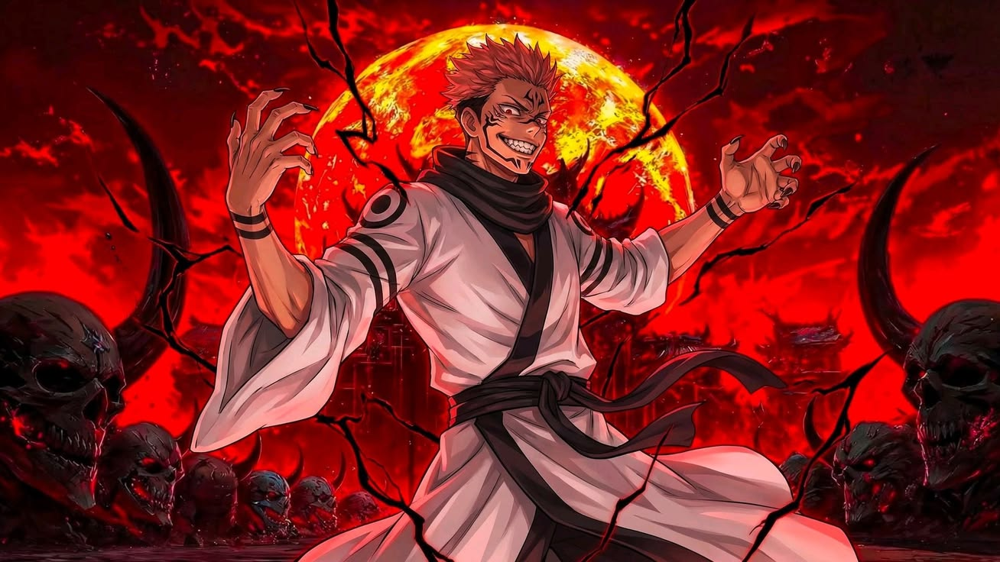

<div align="center">

# Prodi9al Hyprland Config

[](https://hyprland.org/)
[](https://www.lua.org/)
[](https://opensource.org/licenses/MIT)

</div>

---

<div align="center">

<br>

<a href="#installation"><kbd> Installation </kbd></a>&ensp;&ensp;
<a href="#updating"><kbd> Updating </kbd></a>&ensp;&ensp;
<a href="#themes"><kbd> Themes </kbd></a>&ensp;&ensp;
<a href="#styles"><kbd> Styles </kbd></a>&ensp;&ensp;
<a href="#keybinds"><kbd> Keybinds </kbd></a>&ensp;&ensp;
<a href="#prodi-framework"><kbd> Prodi Framework </kbd></a>&ensp;&ensp;

</div><br>

<div align="center">
  <div style="display: flex; flex-wrap: nowrap; justify-content: center;">
    
    
    
    
    
  </div>
</div>

---

## Preview

### Lock Screen Themes (`hyprlock/`)

| Theme | Config File |
|-------|-------------|
| **Prodi9al** (default) | `hyprlock/Prodi9al.conf` |
| SF Pro | `hyprlock/SF Pro.conf` |
| Arfan on Clouds | `hyprlock/Arfan on Clouds.conf` |
| Anurati | `hyprlock/Anurati.conf` |
| IBM Plex | `hyprlock/IBM Plex.conf` |
| IMB Xtented | `hyprlock/IMB Xtented.conf` |
| Greetd Wallbash | `hyprlock/greetd-wallbash.conf` |
| Greetd | `hyprlock/greetd.conf` |

Set the active layout in `hyprlock.conf`:

```bash
$LAYOUT_PATH=/home/prodi9al/.config/hypr/hyprlock/Prodi9al.conf
```

---

<a id="styles"></a>

### Featured Wallpaper

<div align="center">


</div>

From `Configs/.config/hypr/assets/wallpapers/Gojo Satoru/`.

| Wallpaper | Directory |
|-----------|-----------|
| Black Summoner | `Configs/.config/hypr/assets/wallpapers/Black Summoner/` |
| Decay Green | `Configs/.config/hypr/assets/wallpapers/Decay Green/` |
| Gojo Satoru | `Configs/.config/hypr/assets/wallpapers/Gojo Satoru/` |
| Graphite Mono | `Configs/.config/hypr/assets/wallpapers/Graphite Mono/` |
| Kengan Ashura | `Configs/.config/hypr/assets/wallpapers/Kengan Ashura/` |
| Material Sakura | `Configs/.config/hypr/assets/wallpapers/Material Sakura/` |
| Nordic Blue | `Configs/.config/hypr/assets/wallpapers/Nordic Blue/` |
| Sukuna | `Configs/.config/hypr/assets/wallpapers/Sukuna/` |
| The World's Finest Assassin | `Configs/.config/hypr/assets/wallpapers/The World's Finest Assassin/` |

Set wallpaper via `prodi-shell wallpaper` or in `hyprland.lua`:

```lua
hl.env("WALLPAPER_CUSTOM_PATHS", os.getenv("HOME") .. "/Pictures/Wallpapers")
```

---

<a id="themes"></a>


---

All available themes (37 total), each with its own `hypr.theme`, `kitty.theme`, `rofi.theme`, `waybar.theme`, `kvantum/`, and `wallpapers/` set. Organized by series below.

Switch themes with `prodi-shell theme.switch` or `theme.select.sh`.

---

### 🔥 Shonen Action

**Black Clover** — Magic Knights, grimoires, and Asta's anti-magic crusade in a world where magic decides everything *(20 wallpapers)*


**Bleach** — Soul Reapers, Hollows, and Ichigo Kurosaki's journey through the Soul Society *(20 wallpapers)*



**Blue Lock** — Egoistic strikers locked in a brutal competition to become the world's best striker *(20 wallpapers)*


**Demon Slayer** — Tanjiro Kamado's quest to cure his sister Nezuko and slay demons with breathing styles *(37 wallpapers)*


**Dr. Stone** — Senku Ishigami rebuilds civilization from the Stone Age with the power of science *(9 wallpapers)*


**Fullmetal Alchemist: Brotherhood** — The Elric brothers' search for the Philosopher's Stone and the truth of alchemy *(21 wallpapers)*


**High School DxD** — Issei Hyoudou's rise as a devil in a world of angels, fallen angels, and dragons *(23 wallpapers)*


**Hunter x Hunter** — Gon Freecss's quest to find his father and become a top-tier Hunter *(20 wallpapers)*


**Jujutsu Kaisen** — Cursed spirits, jujutsu sorcerers, and Yuji Itadori's battle against the King of Curses *(45 wallpapers)*


**Kaiju No. 8** — Kafka Hibino's fight against kaiju monsters as a member of the Defense Force *(12 wallpapers)*


**My Hero Academy** — Quirk-powered heroes-in-training at U.A. High School aiming to become the Symbol of Peace *(20 wallpapers)*


**Seven Deadly Sins** — Meliodas and the legendary knights framed for treason, clearing their names *(21 wallpapers)*


**Soul Land** — Tang San's cultivation journey in a world where spirit masters wield martial souls *(5 wallpapers)*


**Sword Art Online** — Kirito's fight to escape a virtual death game where dying in-game means dying for real *(20 wallpapers)*


---

### 🌀 Isekai & Fantasy

**Re:Zero** — Subaru Natsuki's Return by Death as he navigates a dangerous fantasy world *(20 wallpapers)*



**That Time I Got Reincarnated as a Slime** — Rimuru Tempest builds a monster nation starting from slime form *(19 wallpapers)*


**The Eminence in Shadow** — Cid Kagenou's delusional shadowbrother fantasy becomes all too real *(20 wallpapers)*


**The Rising of the Shield Hero** — Naofumi Iwatani's betrayal-fueled rise as the Shield Hero *(20 wallpapers)*


---

### 👻 Supernatural & Dark Fantasy

**Death Note** — Light Yagami's deadly game of justice with a notebook that kills anyone whose name is written *(20 wallpapers)*


**Tokyo Ghoul** — Ken Kaneki's transformation into a half-ghoul caught between human and monster worlds *(20 wallpapers)*


---

### ⚔️ Character Themes

**Gojo Satoru** — The strongest jujutsu sorcerer, blindfolded and wielding the Limitless technique *(18 wallpapers)*


**Megumi Fushiguro** — Jujutsu sorcerer commanding the Ten Shadows Technique and its shikigami *(13 wallpapers)*


**Sukuna** — The King of Curses, incarnate and wreaking havoc through Yuji Itadori's body *(19 wallpapers)*



**Yuji Itadori** — Tokyo Jujutsu High first-year and vessel of Ryomen Sukuna *(15 wallpapers)*


---

### ⚡ Cyberpunk & Disney

**Edge Runner** — David Martinez's rise as an edgerunner surviving in the neon-soaked Night City *(5 wallpapers)*


**Mulan** — The warrior who took her father's place in the army, defending China with honor *(2 wallpapers)*


---

### 🌈 Color & Scheme Themes

**Catppuccin Latte** — Pastel light theme from the soothing Catppuccin color palette *(15 wallpapers)*


**Catppuccin Mocha** — Dark coffee-soaked theme from the Catppuccin color palette *(15 wallpapers)*


**Decay Green** — Decay-inspired green scheme with muted, organic tones *(7 wallpapers)*


**Frosted Glass** — Translucent glassmorphism aesthetic with blurred backgrounds *(6 wallpapers)*


**Graphite Mono** — Monochrome graphite tones for a minimalist, professional look *(13 wallpapers)*


**Gruvbox Retro** — Retro 70s-inspired Gruvbox colors with warm, earthy tones *(9 wallpapers)*


**Material Sakura** — Soft pastel cherry blossom palette with gentle pinks and whites *(9 wallpapers)*


**Nordic Blue** — Cool Nordic blues evoking Scandinavian winter landscapes *(8 wallpapers)*


**Rosé Pine** — Soothing rose-pine colors designed for comfort and focus *(17 wallpapers)*


**Synth Wave** — 80s neon retrowave aesthetic with glowing magentas and cyans *(4 wallpapers)*


**Tokyo Night** — Dark neon Tokyo nightscape with deep blues and vibrant accents *(6 wallpapers)*


---

---

<a id="shaders"></a>


---

Fragment shaders for hyprlock/hyprsunset visual effects:

| Shader | Effect |
|--------|--------|
| `blue-light-filter.frag` | Blue light reduction |
| `color-vision.frag` | Color vision simulation |
| `custom.frag` | Combined custom shader |
| `disable.frag` | Disable effects |
| `grayscale.frag` | Grayscale filter |
| `invert-colors.frag` | Color inversion |
| `oled-saver.frag` | OLED screen saver |
| `paper.frag` | Paper texture |
| `vibrance.frag` | Color vibrance boost |
| `wallbash.frag` | Wallbash wallpaper effect |

---

<a id="keybinds"></a>


---

(mainMod = SUPER)

| Key | Action |
|-----|--------|
| `Q` | Launch terminal (`kitty`) |
| `C` | Close window |
| `M` | Shutdown/exit Hyprland |
| `E` | File manager (`dolphin`) |
| `V` | Toggle floating |
| `R` | Menu (`wofi`) |
| `D` | Prodi9al home screen launchpad |
| `A` | Prodi9al app selector |
| `P` | Pseudo-tiling toggle |
| `J` | Toggle split (dwindle) |
| `Arrow keys` | Move focus |
| `SHIFT + Arrow` | Move window (Prodi9al overrides) |
| `0-9` | Switch/move to workspace |
| `SHIFT + 0-9` | Move window to workspace |
| `S` | Toggle scratchpad (`magic`) |
| `SHIFT + S` | Move window to scratchpad |
| `SUPER + scroll` | Cycle workspaces |
| `SUPER + LMB/RMB` | Drag/resize windows |

### Multimedia Keys
| Key | Action |
|-----|--------|
| `XF86AudioRaiseVolume` | Volume +5% |
| `XF86AudioLowerVolume` | Volume -5% |
| `F5` | Mute audio toggle |
| `XF86AudioMicMute` | Mic mute toggle |
| `XF86MonBrightnessUp` | Brightness +5% |
| `XF86MonBrightnessDown` | Brightness -5% |
| `XF86AudioNext` | Next track |
| `XF86AudioPause` / `XF86AudioPlay` | Play/pause |
| `XF86AudioPrev` | Previous track |

---

<a id="prodi-framework"></a>


---

Includes the full Prodi framework so this repo can recreate your complete setup:

| Path | Purpose |
|------|---------|
| `prodi-shell` | CLI tool — lockscreen, theme.switch, wallpaper, reload |
| `prodi-lib/` | Shell, Lua, and Python scripts |
| `prodi-share/` | Rofi themes, config registry, assets |
| `prodi-share-hypr/` | Prodi Lua module (`prodi.lua`, `lua/prodi/`, `schema/`) |

### `prodi-lib/` Scripts
- `display-cycle.sh` — Cycle display/projection modes
- `lockscreen.sh` — Lock screen launcher
- `wallpaper.sh` / `wallbashtoggle.sh` — Wallpaper management
- `brightnesscontrol.sh`, `battery.sh`, `volumecontrol.sh` — Hardware controls
- `cliphist.sh` — Clipboard history
- `rofi.sh`, `rofilaunch.sh` — Rofi integration
- `theme.select.sh`, `theme.switch.sh` — Theme switching
- `config.lua`, `layouts.lua`, `animations.lua` — Lua config modules
- `weather.py`, `mediaplayer.py`, `session.py` — Python utilities

---

## Structure

| Path | Purpose |
|------|---------|
| `hyprland.lua` | Main Hyprland Lua config (keybinds, rules, animations, autostart) |
| `hyprlock.conf` | Hyprlock lock screen config |
| `hypridle.conf` | Hypridle idle actions (dim, lock, DPMS, suspend) |
| `hyprsunset.conf` | Hyprsunset color temperature config |
| `hyprlock/*.conf` | Lock screen layouts & themes |
| `shaders/*.frag` | Fragment shaders for hyprlock/hyprsunset visual effects |
| `themes/colors.conf` | Color theme definitions |
| `assets/rofi-assets/` | Rofi theme preview images |
| `Configs/.config/hypr/assets/wallpapers/` | Wallpaper collections |
| `.gitignore` | Excludes `*.before-*` backups and `hyprlock-backups/` |

---

### Waybar Config

Waybar configuration is shipped under `Configs/.config/waybar/`. It includes:

| File | Purpose |
|------|---------|
| `config.jsonc` | Main waybar bar configuration |
| `modules/custom-htb.jsonc` | Hack The Box rank module |
| `scripts/htb.py` | HTB API fetcher (requires `HTB_TOKEN` and `HTB_USER_ID`) |
| `style.css` / `theme.css` | Bar styling |
| `includes/` | Module includes and shared styles |

**HTB module setup:** Create `~/.config/waybar/scripts/htb_token.env` with your API token:

```bash
export HTB_TOKEN="your_hackthebox_api_token"
```

And set your user ID via environment:

```bash
export HTB_USER_ID="your_htb_user_id"
```

The token file is gitignored — never commit it.

---

### UI Configs

Full desktop UI configuration is shipped under `Configs/`. It includes:

| Path | Purpose |
|------|---------|
| `Configs/.config/dunst` | Notification daemon config |
| `Configs/.config/fastfetch` | System info display |
| `Configs/.config/gtk-3.0` / `Configs/.config/gtk-4.0` | GTK theming |
| `Configs/.config/kitty` | Terminal emulator |
| `Configs/.config/Kvantum` | Qt SVG theme engine |
| `Configs/.config/nwg-look` | GTK config tool settings |
| `Configs/.config/pypr` | Hyprland wrapper config |
| `Configs/.config/qt5ct` / `Configs/.config/qt6ct` | Qt theming |
| `Configs/.config/swaync` | Notification daemon (alt to dunst) |
| `Configs/.config/wlogout` | Logout/shutdown menu UI |
| `Configs/.config/xsettingsd` | X settings daemon |
| `Configs/.config/hyde` | Hyde theme system data |
| `Configs/.local/share/themes` | GTK/Kvantum themes (Catppuccin, Decay-Green, Edge-Runner, etc.) |
| `Configs/.local/share/icons` | Icon themes (BeautyLine, Bibata, Gruvbox, etc.) |
| `Configs/.local/share/fonts` | Font files (JetBrainsMono, MapleMono, Mononoki, etc.) |
| `Configs/.local/share/waybar` | Additional waybar includes, layouts, modules, styles |
| `Configs/.local/share/sddm` | Display manager theme |
| `Configs/.local/share/rofi` | Rofi themes |
| `Configs/.local/share/wallbash` | Wallbash color cache |

All hardcoded paths use `$HOME` or `$XDG_*` placeholders — no personal data is committed.

---

## Repository Structure

| Path | Purpose |
|------|---------|
| `Configs/.config/` | Dotfiles restored to `~/.config/` (hypr, waybar, gtk, kitty, rofi, zsh, fish, etc.) |
| `Configs/.local/` | Dotfiles restored to `~/.local/` (prodi, themes, waybar, rofi, sddm, etc.) |
| `Scripts/install.sh` | Arch Linux install script |
| `Scripts/pkg_core.lst` | Core package list (pacman) |
| `Scripts/pkg_extra.lst` | Extra package list (AUR) |
| `Scripts/restore_cfg.lst` | Config restore manifest |
| `Scripts/uninstall.sh` | Uninstall script |
| `Scripts/install_aur.sh` | AUR package installer |
| `Scripts/restore_cfg.sh` | Config restore script |
| `Scripts/version.sh` | Version info |
| `Scripts/hypr_autogen.sh` | Hyprland config autogenerator |
| `Scripts/themepatcher.lst` | Available themes list |
| `Scripts/dots-groups/` | Dotfile group manifests (core, extra, shell, etc.) |
| `dots.toml` | Dotfile manifest |
| `Source/assets/` | Wallpapers and showcase images |
| `Source/docs/` | Documentation (migration guide, etc.) |
| `Source/misc/` | Miscellaneous source files |
| `LICENSE` | MIT License |
| `CONTRIBUTING.md` | Contribution guidelines |
| `KEYBINDINGS.md` | Keybinding reference |
| `CHANGELOG.md` | Release history |

---

## Installation

### Option 1: Install script (recommended)

```bash
# Clone the repo
gh repo clone Prodi9al/hyprland-config ~/hyprland-config
cd ~/hyprland-config

# Run the Arch Linux installer
./Scripts/install.sh
```

The installer handles dependency installation, backs up existing configs to `~/.config/cfg_backups/`, and restores all dotfiles from `Configs/` to their target locations.

**Options:**
- `./Scripts/install.sh` — Standard install (pacman packages only)
- `./Scripts/install.sh --aur` — Also install AUR packages (requires yay/paru/pamac)

**Other scripts:**
- `./Scripts/uninstall.sh` — Remove all restored dotfiles
- `./Scripts/restore_cfg.sh` — Restore configs from `Configs/` with backup
- `./Scripts/install_aur.sh` — Install AUR packages from `pkg_extra.lst`
- `./Scripts/version.sh` — Show version info

### Option 2: Manual

```bash
# Clone the full setup
gh repo clone Prodi9al/hyprland-config ~/hyprland-config
cd ~/hyprland-config

# Restore .config/ dotfiles
cp -r Configs/.config/* ~/.config/

# Restore .local/ dotfiles
cp -r Configs/.local/* ~/.local/

# Make prodi-shell executable
chmod +x ~/.local/bin/prodi-shell

# Add ~/.local/bin to PATH
echo 'export PATH="$HOME/.local/bin:$PATH"' >> ~/.bashrc
```

### Dependencies (Arch)

Install manually if not using the installer:

```bash
sudo pacman -S --needed \
  hyprland hyprlock hypridle hyprsunset xdg-desktop-portal-hyprland \
  kitty konsole waybar rofi wofi \
  swww hyprpaper mpvpaper awww waydeeper grimblast swappy \
  brightnessctl pamixer pipewire pipewire-pulse polkit polkit-gnome \
  dunst mako fastfetch fzf jq curl wget unzip tar git \
  base-devel make gcc lua luarocks python python-pip \
  xdg-desktop-portal xdg-desktop-portal-gtk kvantum dolphin
```

---

## License

Personal dotfiles — use at your own risk.
